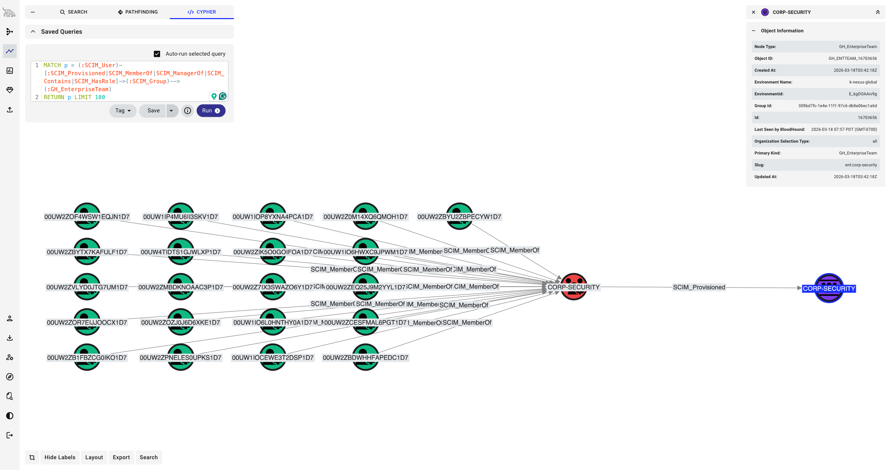

# BloodHound SCIM Schema Extension

**[System for Cross-domain Identity Management (SCIM)](https://scim.cloud/) schema extension for BloodHound**

## Overview

The SCIM protocol is used by various cloud identity providers (IdPs), such as Okta or Entra ID,
to provision [user accounts][SCIM_User] and [groups][SCIM_Group] to/from applications.

This schema extension allows BloodHound to represent SCIM-provisioned [users][SCIM_User] and [groups][SCIM_Group] as nodes in the graph,
avoiding the need to introduce technology-specific edges for each integration, such as Okta+GitHub, Entra+GitHub, or Entra+SalesForce.

## Documentation

For full documentation, see the [BloodHound Docs](https://bloodhound.specterops.io/opengraph/extensions/scim/).

[SCIM_Organization]: https://bloodhound.specterops.io/opengraph/extensions/scim/nodes/scim_organization
[SCIM_User]: https://bloodhound.specterops.io/opengraph/extensions/scim/nodes/scim_user
[SCIM_Group]: https://bloodhound.specterops.io/opengraph/extensions/scim/nodes/scim_group
[SCIM_Role]: https://bloodhound.specterops.io/opengraph/extensions/scim/nodes/scim_role
