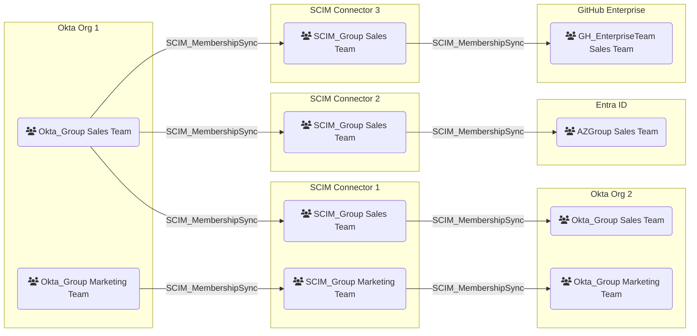

# SCIM_MembershipSync

## Edge Schema

The diagram shows the following directed membership-synchronization relationships:

| Source | Destination |
|--------|-------------|
| [Okta_Group] | [SCIM_Group] |
| [SCIM_Group] | [Okta_Group] |
| [AZGroup] | [SCIM_Group] |
| [SCIM_Group] | [AZGroup] |
| [SCIM_Group] | [GH_EnterpriseTeam](https://bloodhound.specterops.io/opengraph/extensions/github/nodes/gh_enterpriseteam) |

## General Information

The [SCIM_MembershipSync](SCIM_MembershipSync.md) edge represents a configured membership synchronization relationship in which group membership updates flow from the source group to the corresponding destination group through an intermediate [SCIM_Group] resource. Individual edges can point into or out of the SCIM group, following the direction of membership synchronization.

Some applications work with roles or teams instead of traditional groups, but the membership synchronization concept remains the same.

[AZGroup]: https://bloodhound.specterops.io/resources/nodes/az-group
[Okta_Group]: https://bloodhound.specterops.io/opengraph/extensions/okta/nodes/okta_group
[SCIM_Group]: ../nodes/SCIM_Group.md
