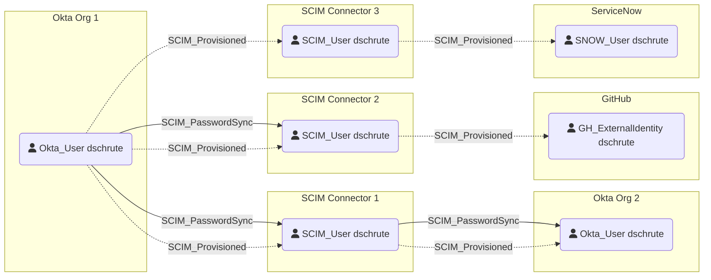

# SCIM_PasswordSync

## Edge Schema

| Source | Destination |
|--------|-------------|
| [Okta_User] | [SCIM_User] |
| [SCIM_User] | [Okta_User] |
| [SCIM_User] | [GH_ExternalIdentity](https://bloodhound.specterops.io/opengraph/extensions/github/nodes/gh_externalidentity) |
| [SCIM_User] | `SNOW_User` |

## General Information

The [SCIM_PasswordSync](SCIM_PasswordSync.md) edge represents a configured password synchronization relationship in which password updates flow from the source user to the corresponding destination user, while transitively crossing the SCIM user resource.
Password synchronization must be supported and enabled on both sides of the integration (source and destination systems) and is not implied by provisioning alone.

[Okta_User]: https://bloodhound.specterops.io/opengraph/extensions/okta/nodes/okta_user
[SCIM_User]: ../nodes/SCIM_User.md
