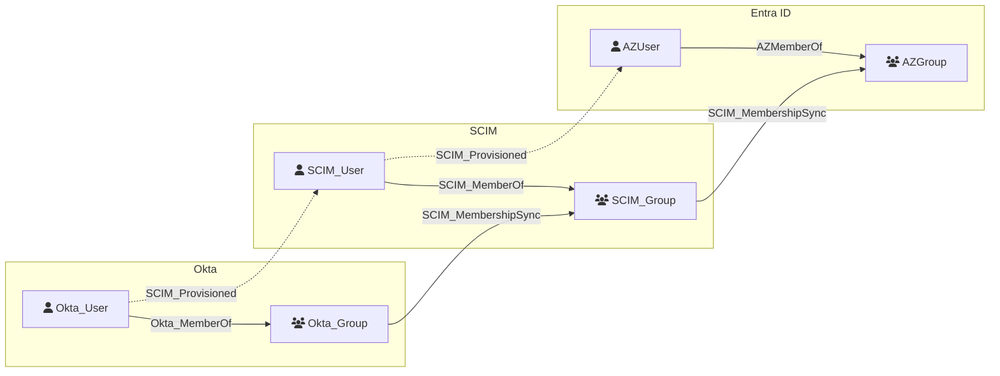

# SCIM_Group

Represents a group resource provisioned via the [System for Cross-domain Identity Management (SCIM)](https://scim.cloud/) protocol. SCIM groups are used by identity providers to organize users and manage access to downstream applications. Group membership changes propagated through SCIM can grant or revoke application access, making groups a key control point for identity governance.

## Properties

| Property | SCIM Property | Type | Description | Sample Value |
| --- | --- | --- | --- | --- |
| `id` | `id`  | `string` | The unique identifier of the group. | `2819c223-7f76-453a-919d-413861904646` |
| `displayName` | `displayName` | `string` | The display name of the group. | `Sales Team` |
| `created` | `meta.created` | `datetime` | The date and time the group was created. | `2010-01-23T04:56:22Z` |
| `lastModified` | `meta.lastModified` | `datetime` | The date and time the group was last modified. | `2011-05-13T04:42:34Z` |

## Diagram

